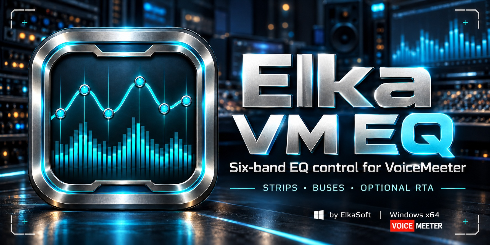

# Elka VM EQ

A standalone Windows EQ controller by ElkaSoft, with six draggable bands, a native C engine, a GPU-accelerated WPF interface, a live level readout and an optional real-time spectrum display. VoiceMeeter performs the audio processing.

[Download the latest release](https://github.com/torment78/Elka.VM.EQ/releases/latest) · [Report an issue](https://github.com/torment78/Elka.VM.EQ/issues) · [♥ Donate on Ko-fi](https://ko-fi.com/msffixit)

## Download and install

Choose a package from [release v0.3.2](https://github.com/torment78/Elka.VM.EQ/releases/tag/v0.3.2):

| Package | Use |
| --- | --- |
| `Elka-VM-EQ-0.3.2-Setup-x64.exe` | Install for your Windows user, with a Start menu shortcut and an optional desktop shortcut. |
| `Elka-VM-EQ-0.3.2-Portable-win-x64.zip` | Extract the folder and run `ElkaVmEq.exe`. No installation required. |
| `Elka-VM-EQ-0.3.2-Artwork.zip` | Icon, portrait and landscape banners, including versions under 1 MB. |
| `SHA256SUMS-0.3.2.txt` | Checksums for verifying the three downloads. |

Close an older Elka VM EQ before updating it. The installer uses `%LOCALAPPDATA%\Programs\ElkaSoft\Elka VM EQ`; uninstall through Windows **Installed apps**.

The app includes its .NET runtime and native engine inside one executable. No separate .NET installation, loose DLLs or `runtimeconfig.json` are needed. Keep the included `Notices` folder when redistributing the portable package. Runtime components extract automatically into Windows' temporary `.net` cache at launch, so portable does not mean zero footprint.

**This release is unsigned.** Windows may show an unknown-publisher warning. Download from this repository and check the supplied SHA-256 hashes before running it.

## Requirements

Windows 10/11 x64 and a compatible, separately installed VoiceMeeter:

| Edition | Available six-band EQ targets |
| --- | --- |
| Potato | Hardware inputs IN1–IN5 and buses A1–A5 / B1–B3 |
| Banana | Buses A1–A3 / B1–B2; not Potato's hardware-input EQ |
| Standard | Does not provide the six-band EQ controlled by this app |

## Quick start

1. Start VoiceMeeter, then open **Elka VM EQ**.
2. Choose **Strip** or **Bus**, then select the input or output you want to control.
3. Choose **All** to link the EQ channels, or a numbered channel to edit it separately.
4. Select one of the **six bands**. Drag its point on the graph or adjust **Frequency**, **Gain** and **Q**.
5. Leave **RTA off** unless you want the optional spectrum display and no other application is using VoiceMeeter's audio callback.

## Controls

- Drag knobs or use the mouse wheel; hold **Shift** for finer adjustments.
- Right-click a knob for numeric entry. Double-click a knob or graph point to reset it.
- Select a filter type for the current band. Pass filters do not use gain in their response.
- **A/B** selects VoiceMeeter's EQ bank. **EQ ON/OFF** preserves the band values.
- Use channel copy, copy all and paste to reuse EQ settings; **Flat** clears the relevant EQ response.
- **Solo curve** changes the drawing only, not audio routing.
- Change the graph's display range to inspect boosts or deep cuts. Drag the title area to move the window and an edge to resize it proportionally.

## Live level and spectrum

The header's **LIVE LEVEL** shows the selected strip's pre-fader level or the bus output level, in dBFS. It works with RTA off. **All** shows the loudest channel; a numbered channel shows that channel. `−∞` means silence and `—` means a reading is unavailable. This is a live reading, not a held peak. A pre-fader reading is not a guarantee of an unprocessed, pre-EQ tap.

The spectrum shows individual frequency components, whereas the header shows the overall level. Speech and music will therefore usually have spectrum peaks below the overall reading. A steady isolated test tone is useful for comparing calibration; the live 500 Hz test was confirmed to match.

### Optional RTA — callback safety

**RTA starts off. Close ElkaFX and any competing VoiceMeeter callback application before enabling it.** Turn RTA off or close Elka VM EQ before restarting that software. The app will not take over a busy callback.

Choose a named post-master bus mix to monitor processed output. The strip tap is documented after input insert, not as post-strip-EQ. A bus mix contains all inputs routed to that bus, not only the currently selected strip.

The muted spectrum shares the EQ graph's frequency axis and left dB scale. It uses peak dBFS, not RMS. **All** takes the maximum spectrum across channels without phase summing. No audio is recorded to disk. The cyan EQ curve is a calculated preview, not a measurement of VoiceMeeter's unpublished filter coefficients.

## What's new in v0.3.2

- Live channel-level readout with stale-data and channel-selection safeguards.
- New app icon and matching portrait/landscape artwork with VoiceMeeter branding.
- Dark installer with the matching artwork.
- Compact orange **♥ Donate** buttons in the app and installer. These open Ko-fi only when clicked; donations are optional.

## Support and development

[Report issues](https://github.com/torment78/Elka.VM.EQ/issues) with your VoiceMeeter edition, selected target and the steps to reproduce the problem. If you would like to support ElkaSoft, [buy me a coffee](https://ko-fi.com/msffixit).

For source builds and validation, see [BUILDING.txt](BUILDING.txt). Detailed controller/analyzer notes are in [README-HYBRID.txt](README-HYBRID.txt).

Independent project; not affiliated with VB-Audio. VoiceMeeter is required separately and its binaries are not redistributed. Bundled Microsoft runtime licenses are included in `Notices/`.
